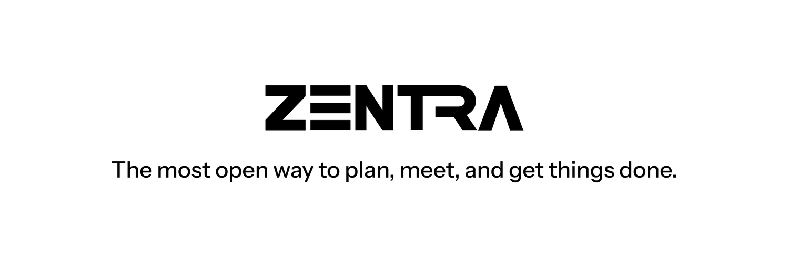

<div align="center">
  <picture>
    <source media="(prefers-color-scheme: dark)" srcset="./.github/assets/zentra-banner-dark.png" />
    <source media="(prefers-color-scheme: light)" srcset="./.github/assets/zentra-banner-light.png" />
    
  </picture>

[](https://vercel.com/tech-art/one-calendar)
[](https://www.typescriptlang.org/)
[](https://bun.sh/)
[](./LICENSE)

  <p>
    <a href="https://docs.xyehr.cn/docs/one-calendar">Documentation</a>
    ·
    <a href="https://xyehr.cn">Website</a>
    ·
    <a href="https://github.com/EvanTechDev/issues">Issues</a>
  </p>
</div>

## Zentra

Zentra is an open-source, self-hostable productivity suite for people who want to own their time and their data. It brings an AI-powered calendar, live video meetings, and a native desktop experience into one workspace, with scheduling, collaboration, reminders, secure identity, and offline access built in.

## Why Zentra

Planning is often split across closed calendars, meeting links, and disconnected productivity tools. Zentra brings those workflows together without asking you to give up portability or control. Whether you need intelligent scheduling, reliable collaboration, or a calendar that remains useful offline, Zentra gives you open source code and a complete product—not another black box around your data.

## Products

| Product        | What it does                                                                                               | Source                                           |
| -------------- | ---------------------------------------------------------------------------------------------------------- | ------------------------------------------------ |
| **Calendar**   | AI-assisted scheduling, recurring events, invitations, reminders, analytics, and MCP integrations          | [`apps/calendar`](./apps/calendar)               |
| **Meet**       | Live video meetings with chat, attendance, and shared Calendar identity                                    | [`apps/meet`](./apps/meet)                       |
| **Desktop**    | Cross-platform Tauri client with native reminders, secure sessions, and encrypted read-only offline access | [`apps/calendar-client`](./apps/calendar-client) |
| **Web & Docs** | Marketing website and task-focused user documentation                                                      | [`apps/web`](./apps/web), [`docs`](./docs)       |

See the [Calendar guide](./apps/calendar/README.md) for local setup and the [Desktop guide](./apps/calendar-client/README.md) for native development and releases.

## Repository map

```text
apps/
  calendar/          Next.js Calendar product and API
  meet/              Next.js LiveKit meeting app
  calendar-client/   Tauri + React desktop client
  web/               Astro marketing site
packages/
  shared/            Calendar product code and meeting domain logic
  agent/             AI tools, parsing, and search
  auth/              Better Auth, security, and cross-app identity
  ui/                Shared interface primitives
  i18n/              Locale generation and translation tooling
  utils/             Generic utilities
docs/                Fumadocs user documentation
tests/               Tests grouped by owning workspace
```

Each app owns its routes and infrastructure. Shared product behavior lives in `packages/`; apps never import one another.

## Contributing

Contributions are welcome. Read [AGENTS.md](./AGENTS.md) for architecture rules, database conventions, testing guidance, and commit requirements. Keep changes focused and run the relevant checks before opening a pull request.

## Support

Zentra is supported by [Cloudflare Project Alexandria](https://blog.cloudflare.com/expanding-our-support-for-oss-projects-with-project-alexandria/).

If Zentra is useful to you, consider starring the repository—it helps others discover the project.

[](https://www.star-history.com/?repos=EvanTechDev%2FOne-Calendar&type=date&legend=top-left)

## License

Made with ❤️ and published under the [MIT License](./LICENSE).
