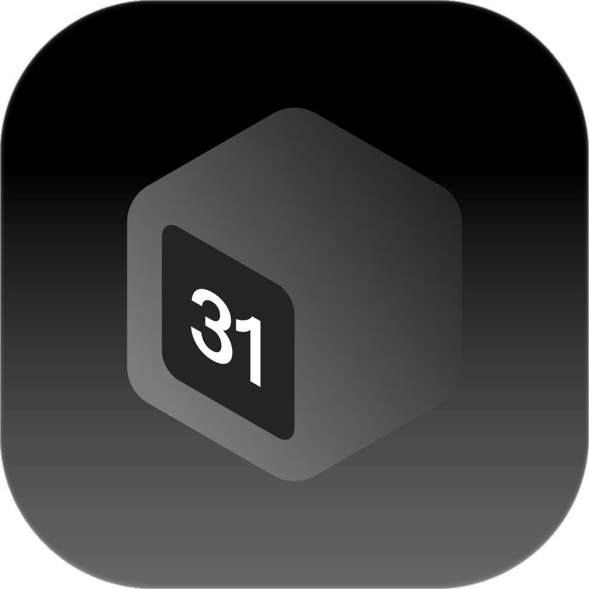

<div align="center">
  

  <h1>Zentra Calendar Desktop</h1>
  <p><strong>Your calendar, with a native home.</strong></p>
  <p>A cross-platform Tauri client with secure sessions, native reminders, signed updates, and encrypted read-only offline access.</p>

  <p>
    <a href="#quick-start">Quick start</a> ·
    <a href="#builds-and-releases">Builds & releases</a> ·
    <a href="./src-tauri/README.md">Native host</a> ·
    <a href="./ACCEPTANCE.md">Acceptance guide</a>
  </p>
</div>

## Highlights

| Capability                 | How it works                                                                                                    |
| -------------------------- | --------------------------------------------------------------------------------------------------------------- |
| **One product, two hosts** | Reuses the Web calendar UI, state, and recurrence engine from `@zntr/shared/calendar`                           |
| **Secure by architecture** | React talks to Rust through `CalendarHost.request`; session cookies stay in Rust and the OS credential store    |
| **Offline access**         | Restores encrypted cached data in read-only mode, with separate device-offline and service-failure states       |
| **Native reminders**       | A Rust worker refreshes recurrence-expanded reminders, tracks delivery per account, and plays the bundled sound |
| **Desktop integration**    | Tray controls, native save dialogs, fullscreen, deep links, and signed updater support                          |
| **Isolated environments**  | Separate app IDs, protocols, credentials, data directories, origins, and update channels for dev and production |

Web keeps its blocking connection-recovery screen. Desktop can browse available cached data offline without allowing writes or losing mounted drafts; all remote data revalidates after recovery.

## Quick start

### Prerequisites

- [Bun 1.4.4](https://bun.sh) and [Node.js 25](https://nodejs.org)
- A desktop OS with the [Tauri prerequisites](https://v2.tauri.app/start/prerequisites/)
- A compatible Calendar backend and its desktop auth routes

From the repository root:

```bash
bun install
bun run --filter calendar-client tauri dev
```

Useful build commands:

```bash
# Type-check and bundle the frontend
bun run --filter calendar-client build

# Build the native installer
bun run --filter calendar-client build:tauri

# Regenerate platform icons from the product logo
bun run --filter calendar-client icons
```

Run native builds on a supported desktop machine. The current Termux environment is for source editing, not installed-app verification.

## Architecture

```text
React calendar
     │ CalendarHost.request
     ▼
Tauri IPC ──► Rust native host ──► Calendar API
     │
     ├── OS credential store
     ├── encrypted offline snapshots
     ├── window, tray, and reminders
     └── native dialogs and signed updates
```

| Layer                       | Responsibility                                                                             |
| --------------------------- | ------------------------------------------------------------------------------------------ |
| `src/`                      | Desktop React shell, session presentation, native host adapter, and styles                 |
| `src-tauri/`                | Authenticated HTTP, credentials, cache, navigation, reminders, updates, and OS integration |
| `packages/shared/calendar/` | Product UI, state, recurrence, and the host interface shared with Web                      |

Streaming responses and request cancellation use the same host port. URL imports use a separate cookie-free native client. Fonts and calendar assets are bundled locally.

## Authentication and navigation

- Sign-in uses the embedded official-origin Better Auth view, authorization codes, and S256 PKCE.
- Exchanging the code creates an independent desktop session. Browser and desktop sign-out do not sign out one another.
- Account settings open through a single-use, 60-second handoff in an ephemeral official-origin view.
- First-party external links can receive an independent browser-session handoff.
- Closing the window hides it in the tray; **Open** and **Quit** are explicit tray actions.
- The default window is 1320 × 880 logical pixels, resizable and maximizable with a 900 × 600 minimum. F11 toggles fullscreen and Escape exits it.

Linux also requires WebKitGTK 4.1, a Secret Service credential store, an application-indicator provider, `desktop-file-utils`, and `xdg-utils`. The last two register the browser-login callback.

## Build environments

`ZENTRA_DESKTOP_ENV` selects `dev` or `production`; `ZENTRA_API_ORIGIN` supplies an HTTPS origin. Cargo reads both at compile time.

| Environment  | Default API origin          | Additional configuration                                  |
| ------------ | --------------------------- | --------------------------------------------------------- |
| `dev`        | `https://precal.xyehr.cn`   | `--config src-tauri/tauri.dev.conf.json`                  |
| `production` | `https://calendar.xyehr.cn` | `src-tauri/tauri.release.conf.json` during release builds |

Names, application IDs, deep-link schemes, credentials, application data, and update channels are isolated. The runtime rejects an environment/application-ID mismatch.

Deploy the matching Calendar backend before distributing a client. Desktop sign-in requires the `/api/auth/desktop/*` routes, the native OAuth registration, and current database migrations, including `0022_relax_legacy_account_issuer.sql`.

## Builds and releases

Both desktop workflows are manually dispatched and contain no tests, native smoke checks, or visual captures.

### Build

**Actions → Build → Run workflow** produces unsigned dev artifacts:

| Platform | Architecture         | Artifact       |
| -------- | -------------------- | -------------- |
| Linux    | x64, ARM64           | AppImage       |
| Windows  | x64, ARM64           | NSIS installer |
| macOS    | Intel, Apple Silicon | DMG            |

Apple Silicon uses the standard `macos-15` runner. Native acceptance remains a separate manual gate.

### Desktop Release

Run **Desktop Release** with a semantic `version` (`X.Y.Z`) and an `environment` of `dev` or `production`. Configure the corresponding GitHub environment:

| Environment          | Required settings                                                |
| -------------------- | ---------------------------------------------------------------- |
| `desktop-dev`        | `ZENTRA_UPDATER_PUBLIC_KEY` variable and updater signing secrets |
| `desktop-production` | Independent production public key and signing secrets            |

Secrets:

- `TAURI_SIGNING_PRIVATE_KEY`
- Optional `TAURI_SIGNING_PRIVATE_KEY_PASSWORD`

Repository variables `ZENTRA_DEV_API_ORIGIN` and `ZENTRA_API_ORIGIN` can override public API origins.

All six signed installer builds must succeed before publication. Versioned releases are immutable; `desktop-dev` and `desktop-stable` channel releases hold `latest.json` pointing to their signed assets. Versions must increase independently in each channel. If publishing stops after creating a draft, inspect and remove that unpublished draft before retrying the same version.

Users explicitly check, download, and restart to install updates. Tauri verifies updater signatures. Windows installers currently have no publisher signature; macOS installers have no Developer ID notarization.

## Validation

Follow [ACCEPTANCE.md](./ACCEPTANCE.md) for real installed-app coverage, including cold offline launch, read-only enforcement, account cleanup, reminders, tray behavior, and signed updates. Record results against the exact source revision in CORE-225 and its child issues.

Run the real PostgreSQL authentication contract separately from the build workflow. Earlier installers do not establish acceptance for later source revisions, and native startup, session restoration, reminders, and updates each need their own evidence.
